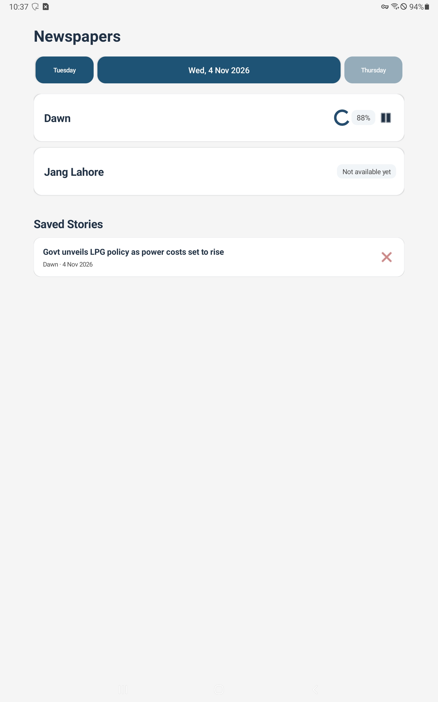
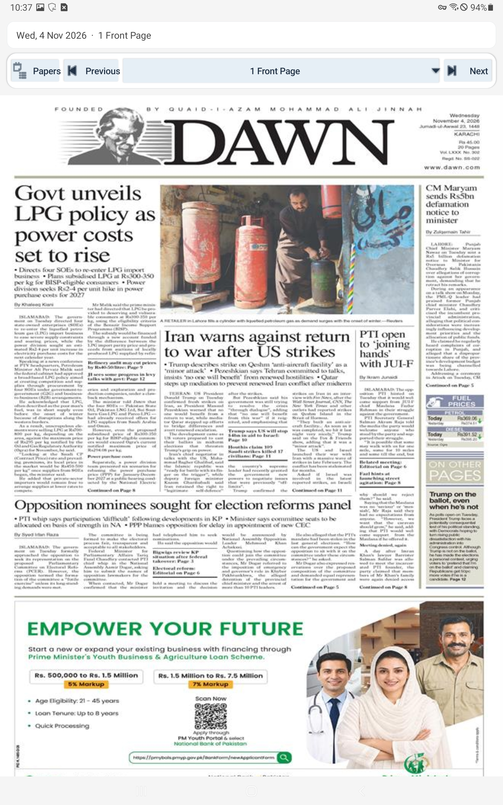

# E-Paper

E-Paper is a simple Android reader for Dawn and Jang Lahore newspapers. Download an edition once and read it even when the internet is unavailable.

This app was originally built for personal use on a Samsung Galaxy Tab S5e. It is also useful for other android users and people with limited or unreliable internet connections.

## Screenshots

<p align="center">
  
  
  
  
</p>

## Read offline

- Choose Dawn or Jang Lahore.
- Browse newspapers by date.
- Download complete editions or open individual pages.
- Read saved pages and stories without internet access.
- Tap a story to read the full text.
- Zoom newspaper pages and article images.
- Receive a notification when today's newspaper becomes available.

Downloaded editions remain on your device until you remove them.

## Installation

Install the app on an Android device running Android 8.0 (API 26) or newer. A tablet works especially well for the full newspaper-page view.

An internet connection is needed to download a newspaper edition. After it is downloaded, you can read it offline.

## Privacy and storage

The app checks the newspapers' websites for new editions and saves downloaded pages and stories only in its private storage on your device. It does not upload your reading activity.

## License

This project is licensed under the Apache License 2.0. See [LICENSE](LICENSE).

## Development

Open the project in Android Studio and sync Gradle, or build it from the command line:

```sh
./build_debug.sh
```

The resulting debug APK is written to:

```text
app/build/outputs/apk/debug/app-debug.apk
```
